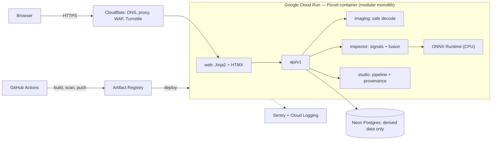

# Picxel — Project Bible

> **See what's really in your pixels.**
> An open-source web app that inspects any image for signs of AI generation and provenance, then exports a pixel-perfect version for any platform — with its disclosure intact.

| | |
|---|---|
| **Plan version** | 1.1 — owner confirmations + Phase 0 adjustments (D-003 … D-008) |
| **Created** | 2026-09-14 · **Updated** 2026-09-15 |
| **Product owner** | Project owner (GitHub `Billu07`) |
| **Lead engineer** | Claude (senior developer) |
| **Status** | Phase 0 — Foundations in progress |
| **Production URL** | https://picxel.autolinium.com · staging: https://picxel-staging.autolinium.com |
| **Repository** | https://github.com/Billu07/Picxel |
| **Companion files** | [`agent.md`](agent.md) — current state · [`decision.md`](decision.md) — deviations log |

**How this file works:** it defines *what* we build and *why*. It changes rarely and deliberately. To change it: (1) log the deviation in `decision.md`, (2) edit the relevant section here, (3) bump the plan version, (4) note it in `agent.md`.

---

## Contents
1. [Vision & positioning](#1-vision--positioning)
2. [Principles](#2-principles-non-negotiable)
3. [Scope & non-goals](#3-scope--non-goals)
4. [Users & use cases](#4-users--use-cases)
5. [Product features](#5-product-features)
6. [System architecture](#6-system-architecture)
7. [Tech stack — baseline decisions](#7-tech-stack--baseline-decisions)
8. [Inspector — detection engine](#8-inspector--detection-engine)
9. [Studio — optimization pipeline](#9-studio--optimization-pipeline)
10. [Data model & API](#10-data-model--api)
11. [Infrastructure, environments & cost control](#11-infrastructure-environments--cost-control)
12. [Security, privacy & abuse](#12-security-privacy--abuse)
13. [Brand & experience design](#13-brand--experience-design)
14. [Monetization](#14-monetization)
15. [Open source & community](#15-open-source--community)
16. [Engineering workflow & quality bar](#16-engineering-workflow--quality-bar)
17. [Repository layout](#17-repository-layout)
18. [Roadmap — phase by phase](#18-roadmap--phase-by-phase)
19. [KPIs](#19-kpis)
20. [Risk register](#20-risk-register)
21. [Glossary](#21-glossary)

---

## 1. Vision & positioning

**Problem.** People can no longer tell whether an image is AI-generated, and the tools that claim to know are black boxes that print a percentage with no explanation. Meanwhile, creators lose image quality every time a platform resizes and recompresses their uploads.

**Solution.** Picxel is two tools in one branded web app:
- **Inspector** — upload an image, get an honest, explained report: AI-generation signals, Content Credentials (C2PA), metadata, known watermarks, forensic views, and a probabilistic verdict.
- **Studio** — export the image at the exact size, color space, sharpness and encoding each platform expects, so it survives platform recompression looking its best. Privacy data (GPS, serial numbers) is removed; AI disclosure and provenance are **preserved**.

**Positioning:** *the honest image tool* — open source, explains its reasoning, publishes its accuracy, stores nothing.

**Differentiators** (full competitive teardown in Phase 0):

| Picxel | Typical AI-detector sites |
|---|---|
| Evidence cards explain *why* | Single opaque percentage |
| Detection + provenance + metadata + watermarks in one report | Usually one signal |
| Public model cards & evaluation numbers | Accuracy claims without method |
| Images never stored | Retention often unclear |
| Open source, self-hostable | Closed |
| Creator export Studio included | Detection only |

---

## 2. Principles (non-negotiable)

1. **Honest pixels.** Picxel never helps hide the origin of an image.
   **The detector test:** *if a feature's success metric improves when an AI detector, watermark, or disclosure label fails, we don't build it.* (See D-001.)
2. **Signals, not accusations.** Verdicts are probabilistic bands with visible limitations. Falsely flagging a real photo is our worst failure, so we optimize false-positive rate first.
3. **Privacy by default.** Images are processed in memory and discarded at the end of the request — never stored, never logged, never used for training.
4. **Transparent by design.** Open code, published model cards, metrics, known failure modes, public changelog.
5. **Free-tier native.** Runs at $0 at launch scale, with hard cost caps enforced in configuration — not in hope.
6. **Quality over breadth.** Fewer features, each polished, fast, and accessible.
7. **Contributor-first.** Anyone can run the full app locally with one command in under 10 minutes.

---

## 3. Scope & non-goals

### In scope (v1)
- Image Inspector (JPEG, PNG, WebP, HEIC/HEIF, AVIF)
- Studio exports for major social platforms
- Learn hub and platform guides (value for users, content for AdSense)
- Shareable reports (derived data only — no images)
- Open-source repository, docs, transparency page

### Non-goals — hard boundaries (never, regardless of demand)
- ❌ Removing, masking, or degrading AI watermarks, C2PA manifests, or AI-disclosure metadata
- ❌ Adversarial perturbations or any processing tuned against detector scores
- ❌ Showing detector before/after scores for Studio outputs
- ❌ Storing user images or training on them
- ❌ Claiming certainty ("100% accurate", "proof", "fake")

### Not now (future consideration — requires a decision entry)
- Video, audio, or text detection
- User accounts
- Public third-party API
- Inspect-by-URL (needs SSRF hardening)

---

## 4. Users & use cases

| Persona | Job to be done | Primary feature |
|---|---|---|
| **Everyday social user** | "Is this viral image real before I share it?" | Inspector |
| **Journalist / fact-checker / moderator** | "I need evidence I can cite, not a guess." | Inspector report, provenance details, share link |
| **Photographer with a mislabeled photo** | "Why did my real photo get an AI label?" | Inspector → *What platforms will see* + guidance |
| **Creator / marketer / disclosed AI artist** | "My uploads look soft and blotchy after posting." | Studio |
| **Developer / researcher** | "I want an open, measurable detector to build on." | Repo, eval harness, model cards |

**Photographer guidance rule:** we explain which signals the file carries and what platform policies say about them. If a generative tool was used, the disclosure is accurate and we don't remove it. For purely camera-captured work, we point to signed-capture provenance (Content Credentials).

---

## 5. Product features

### 5.1 Inspector

| Feature | When | Notes |
|---|---|---|
| Upload: drag & drop, file picker, paste | MVP | Max 20 MB / 50 MP; type checked by magic bytes |
| Provenance signal (C2PA / Content Credentials) | MVP | Manifest validity, claim generator, actions, signer, digital source type |
| Metadata signal (EXIF / XMP / IPTC / PNG text chunks) | MVP | IPTC DigitalSourceType, generator parameters, software tags. **Missing metadata is not evidence** |
| Watermark signal | MVP | Open decoders only, license-checked |
| ML classifier signal | MVP | Calibrated probability from the Picxel detector (§8.4) |
| Forensic views (ELA, noise residual, frequency spectrum) | MVP | Explainability only; zero weight in verdict v1 |
| Verdict band + confidence + limitations | MVP | §8.3 |
| *What platforms will see* | MVP | Lists the machine-readable AI signals the file carries; no claim to predict any platform's exact labeling |
| "Were we right?" feedback | MVP | Label + optional note; no image kept |
| Shareable report link | MVP | Derived, non-personal data only; 30-day expiry |
| Downloadable PDF report | Phase 6 | |
| Inspect by URL | Phase 6 | SSRF-hardened fetcher |
| Edited-region heatmap | Phase 6 | Research-dependent |

### 5.2 Studio

| Feature | When | Notes |
|---|---|---|
| Platform presets (YAML, versioned, community-maintained) | MVP | ≥ 12 at launch; each has `source_url` + `verified_on` |
| Smart crop, manual crop, fit-with-padding | MVP | Safe-zone overlays for stories/reels |
| Color management → sRGB | MVP | ICC-correct via LittleCMS |
| Linear-light high-quality resize | MVP | Lanczos; multi-step for large downscales |
| Scale-aware output sharpening | MVP | Luminance channel only |
| Deband dithering | MVP | Flat gradients only; prevents 8-bit banding after recompression |
| Encoder tuning | MVP | Quality search against SSIM / byte targets per preset |
| Privacy scrub (GPS, serials, camera owner name) | MVP | On by default; removed fields listed to the user |
| Disclosure & provenance carry-forward | MVP | **Launch blocker** (§9.3) |
| Before/after comparison slider | MVP | Visual + SSIM + file size — never detector scores |
| Batch export (ZIP) | Phase 6 | |
| Upscaling for undersized images | Phase 6 | ONNX, license-checked |

### 5.3 Website pages
Home (tool above the fold) · Report · Studio · Learn hub · Platform size guides · Transparency (model card, metrics, failure modes) · Open source / Contribute · Sponsors · Changelog · About / Contact · Privacy · Terms · Acceptable Use · Cookies

---

## 6. System architecture

A **modular monolith**: one FastAPI container with strict internal boundaries. Simple to run, deploy, and contribute to; can be split later if metrics demand it.



**Boundary rules** (enforced by `import-linter` in CI):
- `studio` must not import `inspector` detectors — structurally prevents tuning exports against detection.
- `inspector` and `studio` depend on `imaging`; never the reverse.
- Only `api` and `web` touch HTTP; only `db` touches SQL.

**Inspect request lifecycle:** Turnstile check → size/type validation → decode in sandboxed subprocess → signals run concurrently (metadata, C2PA, watermark, classifier) → fusion → derived fields persisted → response → image bytes released in `finally`.

Processing is synchronous for MVP (no queue). **Revisit if** p95 > 10 s → move to Cloud Tasks jobs.

---

## 7. Tech stack — baseline decisions

| Layer | Choice | Why | Revisit if |
|---|---|---|---|
| Language | Python 3.12+ | Owner preference; best imaging/ML ecosystem | — |
| Project & deps | uv (`pyproject.toml` + `uv.lock`) | Fast, reproducible, one tool | — |
| Web framework | FastAPI + Uvicorn | Typed, async, automatic OpenAPI | — |
| Frontend | Jinja2 + HTMX + small vanilla JS modules; Tailwind CSS via standalone CLI | Server-rendered = SEO/AdSense-friendly, strict CSP possible, one deployable, no Node in production, Python contributors work end to end | Studio interactions outgrow HTMX → add isolated JS islands, not an SPA rewrite |
| Imaging | Pillow, pillow-heif, NumPy, OpenCV (headless), scikit-image | Mature, wheels everywhere | — |
| Color | Pillow ImageCms (LittleCMS) | ICC-correct conversions | — |
| Metadata | ExifTool (binary in container) via PyExifTool | Most complete EXIF/XMP/IPTC reader/writer | Container size or licensing issue |
| Provenance | `c2pa-python` (Content Authenticity Initiative SDK) | Official read / validate / sign | — |
| Inference | ONNX Runtime (CPU), INT8-quantized models | Small image, fast on CPU, no PyTorch in production | Latency targets unreachable on CPU |
| Training / eval | PyTorch + Hugging Face libraries, `eval` dependency group only | Keeps the production image lean | — |
| Database | Neon Postgres + SQLAlchemy 2 (sync engine, psycopg 3) + Alembic | Free, real Postgres, branching for staging, portable; one driver on every OS (D-005) | Limits hit → Supabase or managed Postgres; DB time shows up in p95 → revisit async |
| Hosting | Google Cloud Run | Scale-to-zero, generous free tier, enough RAM for models (D-002) | Always-on becomes cheaper, or free tier changes |
| Edge | Cloudflare (DNS, proxy, WAF, rate limiting, Turnstile, Web Analytics) | Free; shields the free tier from bots | — |
| Errors | Sentry (free plan) | Fast triage | Event quota exceeded |
| Testing | pytest, Hypothesis, Playwright (Python) + axe | Unit → property → e2e + accessibility | — |
| Code quality | ruff (lint + format), mypy (strict on core packages), import-linter, pre-commit | One-command consistency; enforced boundaries | A faster type checker matures |
| Security scanning | pip-audit, Trivy, Dependabot | Free supply-chain hygiene | — |
| CI/CD | GitHub Actions | Free for public repos | — |
| Docs | Static docs site on GitHub Pages (tool chosen in Phase 5) | Free, versioned with code | — |
| License | AGPL-3.0-or-later (code), CC BY 4.0 (docs/content) | Keeps hosted forks open; **accepted** (D-003) | — |

---

## 8. Inspector — detection engine

### 8.1 Signal contract
Every detector is a plugin returning the same shape — testable, swappable, easy to contribute.

```python
class Signal(BaseModel):
    id: str  # "c2pa", "metadata", "watermark.dwtdct", "classifier.picxel-v1"
    kind: Literal["provenance", "metadata", "watermark", "classifier", "forensic"]
    finding: Literal["ai_generated", "ai_edited", "camera_captured", "no_signal", "error"]
    strength: Literal["conclusive", "strong", "moderate", "weak", "none"]
    p_ai: float | None  # calibrated probability — classifiers only
    evidence: list[Evidence]  # human-readable facts for evidence cards
    version: str  # signal + model version, for reproducibility
    duration_ms: int
```

### 8.2 Signals

| Signal | Reads | Strength | Caveat |
|---|---|---|---|
| **C2PA provenance** | Manifest validity, claim generator, actions, `digitalSourceType` (e.g. `trainedAlgorithmicMedia`), signer | Conclusive when valid and declaring AI; strong for signed camera capture | Easily stripped — absence means nothing |
| **Metadata** | IPTC DigitalSourceType, XMP, EXIF Software, PNG text chunks (generation parameters, node-graph workflows) | Strong | Forgeable → never conclusive |
| **Watermarks** | Open-source invisible-watermark decoders (e.g. the DWT-DCT mark used by some Stable Diffusion reference pipelines; other open watermark models if licenses allow) | Strong → conclusive, per measured decoder FPR | Proprietary watermarks only via official APIs, if and when available |
| **Classifier** | Pixels → calibrated P(AI) | Moderate → strong, per band | Weaker on heavy recompression, partial edits, brand-new generators |
| **Forensic views** | ELA, noise residual, FFT spectrum, JPEG quantization hints | None (explainability) | Easy to misread → each ships with "how to read this" |

### 8.3 Fusion & verdict bands (v1: deterministic rules + calibrated thresholds)
Evaluated in order; first match wins.

1. Valid C2PA manifest declaring AI generation → **AI-generated (declared)** · declaring AI editing → **AI-edited (declared)**
2. Known watermark detected above decoder threshold → **AI-generated (watermark)**
3. Metadata declares AI generation → **Likely AI-generated (metadata)**, shown alongside the classifier result
4. Classifier `p_ai ≥ T_high` → **Likely AI-generated**
5. Valid C2PA camera-capture manifest, no AI actions, classifier below `T_high` → **Camera-signed, no AI signals**
6. `p_ai ≤ T_low` → **No AI signals found** (never "real" or "authentic")
7. Otherwise → **Inconclusive**

- `T_high` is set so real-photo FPR ≤ 2% on the held-out in-the-wild test split; `T_low` so ≤ 10% of AI test images fall below it.
- Thresholds live in `models/registry.yaml` — never hard-coded.
- Every report shows: verdict, confidence, evidence cards, limitations, model version, and *"Not suitable as sole evidence for legal, employment, or academic decisions."*

### 8.4 The Picxel detector (classifier strategy)
- **Architecture v1:** frozen, permissively licensed vision backbone + small trained head (logistic regression / MLP). Features from large pretrained vision models generalize across unseen generators better than training from scratch (cf. UnivFD, Ojha et al., CVPR 2023).
- **Backbone candidates** (license and model-card restrictions verified before use): DINOv2, SigLIP / SigLIP 2, OpenCLIP variants.
- **Third-party open detectors:** benchmarked as baselines; used in production **only** if the license permits commercial (ad-supported) use.
- **Multi-crop inference:** crop count tuned for accuracy vs. latency.
- **Export:** ONNX → INT8 quantization → accuracy loss must be ≤ 1 pt AUC.

### 8.5 Data & evaluation (`eval/`)
- **License register** — `eval/sources.yaml` (machine-readable) + `eval/LICENSES.md`: every source, license, commercial-use status, ToS notes. CI fails if a manifest references an unregistered source.
- **Dataset v1 targets:** ≥ 10k real photos (diverse devices, scenes, skin tones, lighting, edit levels) and ≥ 10k AI images across ≥ 10 generator families (open-weight and hosted; generator terms checked).
- **Splits:** train / val / test / **in-the-wild** — images passed through realistic social-media processing (resizing, JPEG/WebP recompression, screenshots, crops).
- **Metrics:** ROC-AUC · TPR @ 1% FPR (primary) · real-photo FPR at `T_high` (gate) · ECE (calibration) · per-generator TPR · per-transformation robustness · CPU latency.
- **Promotion gate:** a new model version ships only if it meets or beats production on gate metrics; the report is committed and summarized on the Transparency page.
- **Refresh cadence:** monthly check for new generator families → add samples, retrain head, re-evaluate.
- **Drift watch:** alert when the production verdict distribution shifts significantly week over week (new generator or a bug).

### 8.6 Latency budget (warm instance, 2 vCPU)

| Stage | p95 |
|---|---|
| Validate + decode | 300 ms |
| Metadata + C2PA | 500 ms |
| Watermark decoders | 500 ms |
| Classifier | 2.5 s |
| Fusion + persist + render | 200 ms |
| **Total** | **≤ 5 s** (cold start ≤ 15 s, with progress UI) |

---

## 9. Studio — optimization pipeline

### 9.1 Pipeline
```
decode → validate → apply EXIF orientation
→ ICC convert to linear-light sRGB (float32)
→ crop / fit to preset aspect (smart crop | manual | pad)
→ resize (Lanczos in linear light; multi-step when downscale > 4×)
→ output sharpening (scale-aware unsharp mask, luminance only)
→ sRGB gamma encode → deband dither (flat gradients only) → 8-bit quantize
→ encode (preset format; quality search to SSIM / byte targets)
→ metadata policy (scrub privacy fields; keep credit, copyright, AI disclosure)
→ provenance (new C2PA manifest: original as ingredient + actions; signed)
→ output + change report
```

### 9.2 Presets (`app/studio/presets/*.yaml`)
```yaml
id: instagram-feed-portrait
platform: Instagram
label: Feed post — portrait (4:5)
width: 1080
height: 1350
format: jpeg
sharpen: medium
safe_zone: null        # stories/reels define top/bottom UI overlay zones
source_url: null       # official help-center page — required before launch
verified_on: null      # YYYY-MM-DD when checked against source_url
```
- Validated against a schema at startup and in CI.
- Presets without `source_url` + `verified_on` are hidden in production.
- The easiest first contribution for newcomers.

### 9.3 Metadata & provenance policy (launch blocker)

| Data | Action |
|---|---|
| GPS, device serial numbers, camera owner name, embedded thumbnails | **Removed** by default; user sees the list |
| Creator credit, copyright | Kept (user toggle, default on) |
| IPTC DigitalSourceType and any AI-disclosure fields | **Always kept** |
| C2PA manifest | New manifest written with the original as **ingredient** and edits recorded as actions (e.g. resize, color adjustment), signed with the Picxel key (GCP Secret Manager) |
| ICC profile | Converted to sRGB; compact sRGB profile embedded |

Our signing certificate will not be on public C2PA trust lists at launch, so verifiers may show an "unrecognized signer." The UI explains this; trust-list options are revisited after launch (R10).

### 9.4 Guardrail tests (required CI checks)
- `test_disclosure_preserved` — every fixture carrying AI disclosure (IPTC or C2PA) still declares it after export, for every preset.
- `test_provenance_chain` — exported C2PA manifest validates structurally and references the original as ingredient.
- `test_studio_boundary` — import-linter contract: `studio` cannot import detectors.
- `test_dimensions_exact` (Hypothesis) — output dimensions always equal preset dimensions.
- Golden visual regression — SSIM vs. stored golden outputs within tolerance.

---

## 10. Data model & API

### 10.1 What we store — and don't
**Never stored:** image bytes, thumbnails, perceptual hashes, raw metadata, GPS/serial values, IP addresses in the database.

| Table | Key columns | Retention |
|---|---|---|
| `analyses` | `id` (UUIDv7), `created_at`, `verdict_band`, `p_ai`, `signals_summary` (JSONB, non-personal fields only), `model_version`, `duration_ms`, `mime`, `width`, `height`, `share_slug`, `share_expires_at` | 90 days → rolled into `daily_stats` |
| `studio_exports` | `id`, `created_at`, `preset_id`, `in_mime`, `out_mime`, `in_w`, `in_h`, `out_w`, `out_h`, `duration_ms`, `disclosure_preserved`, `provenance_written` | 90 days → `daily_stats` |
| `feedback` | `id`, `created_at`, `analysis_id` (nullable), `verdict_band`, `model_version`, `user_label` (`ai`/`real`/`unsure`), `note` (≤ 500 chars) | Kept (anonymous) |
| `model_versions` | `name`, `version`, `sha256`, `license`, `thresholds`, `metrics`, `activated_at` | Kept |
| `daily_stats` | `date`, counts by verdict band / preset / format, p50/p95 durations | Kept |

### 10.2 API v1

| Method | Path | Purpose |
|---|---|---|
| `POST` | `/api/v1/inspect` | Multipart image + Turnstile token → report JSON |
| `POST` | `/api/v1/studio/export` | Multipart image + preset + options → JSON change report + base64 output (exports are ≤ ~2 MB by design) |
| `GET` | `/api/v1/presets` | Published presets |
| `POST` | `/api/v1/feedback` | Verdict feedback |
| `GET` | `/api/v1/health` | Liveness + models loaded |
| `GET` | `/api/v1/version` | Git SHA + model versions |
| `GET` | `/r/{slug}` | Shareable report page (HTML) |

Errors follow RFC 9457 (`application/problem+json`). OpenAPI docs at `/api/docs`.

---

## 11. Infrastructure, environments & cost control

### 11.1 Environments

| Env | Runs on | Database | URL |
|---|---|---|---|
| Local | `docker compose` (app + Postgres) or `uv run` | Local Postgres | `localhost:8000` |
| Staging | Cloud Run `picxel-staging` | Neon branch `staging` | `picxel-staging.autolinium.com` (Cloudflare Access) |
| Production | Cloud Run `picxel-prod` | Neon branch `main` | `picxel.autolinium.com` |

Staging uses a first-level subdomain (`picxel-staging.`, not `staging.picxel.`) because Cloudflare's free Universal SSL covers only one subdomain level.

Deploys: merge to `main` → staging automatically · tag `vX.Y.Z` → production after manual approval (GitHub Environments).

### 11.2 Custom domain (Phase 0 spike → result logged in `decision.md`)
- **A:** Cloud Run domain mapping (region must support it) + Cloudflare DNS — may require DNS-only mode, losing proxy/WAF
- **B:** Firebase Hosting rewrite → Cloud Run
- **C:** Cloudflare Worker reverse proxy → `*.run.app`
- **Excluded:** Google external HTTPS load balancer (fixed monthly cost)

### 11.3 Cost guardrails (configured on day one, before any public URL)
- Cloud Run: `min-instances=0`, `max-instances=3`, request-based billing, concurrency starts at 4 (tuned in Phase 2), memory 2–4 GiB
- GCP budget alerts at $1 / $5 / $10 (email); optional kill switch: budget → Pub/Sub → function that disables billing
- Artifact Registry cleanup policy: keep last 5 images
- Cloudflare rate-limiting rule on `/api/*`; Turnstile on inspect and export
- Any change to these caps requires a decision entry

### 11.4 Free-tier budget (approximate — **verify in Phase 0**; providers change limits)

| Service | Free allowance (approx.) | Expected launch usage |
|---|---|---|
| Cloud Run | 2M requests, 180k vCPU-s, 360k GiB-s / month | ≈ 6 vCPU-s + 12 GiB-s per inspection (3 s × 2 vCPU × 4 GiB) → ≈ 30k inspections/month free |
| Artifact Registry | 0.5 GB storage | Images with models may exceed → cents/month |
| Neon Postgres | ~0.5 GB storage | ~1 KB per analysis row + rollups |
| Cloudflare | DNS, proxy, Turnstile, Web Analytics, basic WAF | Well within |
| Sentry | Free-plan event quota | Sample if needed |
| GitHub | Actions (public repo), Pages, Sponsors | Well within |

### 11.5 Leave-the-free-tier triggers
- Monthly infra cost > $10 and not covered by revenue → optimize first (concurrency, model size), then decide
- Cold starts cause > 5% upload abandonment → consider `min-instances=1` once ad revenue covers it
- Neon storage > 80% → tighten retention or upgrade

---

## 12. Security, privacy & abuse

### 12.1 Upload & processing safety
- Type detection by magic bytes; allow-list: JPEG, PNG, WebP, HEIC/HEIF, AVIF. No SVG, no animated formats in v1
- Limits: 20 MB, 50 MP (decompression-bomb guard is a hard error), 30 s request timeout
- Decode in a sandboxed subprocess with memory/CPU limits — a malicious file can't take down the server
- Temp files only on in-memory tmpfs, deleted in `finally`; ExifTool invoked without a shell, fixed arguments
- Outputs always re-encoded; uploaded bytes never echoed back
- Nightly decoder fuzzing with a malformed-file corpus

### 12.2 Web & supply chain
- Strict CSP with nonces (ad-network allowances scoped in Phase 4), HSTS, `X-Content-Type-Options`, `Referrer-Policy`, `Permissions-Policy`
- CSRF tokens on state-changing forms; Turnstile verified server-side
- Locked dependencies (`uv.lock`), Dependabot, pip-audit, Trivy image scan, ruff security rules
- Container: slim base, non-root user, read-only filesystem except tmpfs
- Secrets only in GitHub Environments + GCP Secret Manager; `SECURITY.md` + `security.txt`

### 12.3 Privacy
- No image retention, no training on uploads — stated in plain words next to the upload box
- Cookieless analytics (Cloudflare Web Analytics); ads require consent → **Google-certified CMP** for EEA/UK/Switzerland traffic
- Cloud Run request logs include client IPs → disclosed in privacy policy, log retention kept minimal
- Privacy policy, terms, AUP, cookie policy drafted in Phase 2; **legal review in the owner's jurisdiction before public launch**

### 12.4 Abuse & responsible detection
- AUP: no illegal content; no using reports to harass or defame individuals
- No images stored or served; shared reports contain no pixels
- Abuse contact + runbook (triage, share-link takedown, law-enforcement requests)
- Language rules: "signals," never "fake"; limitations on every report; no verdicts about *people*

---

## 13. Brand & experience design

### 13.1 Identity
- **Name:** Picxel (working name — domain, trademark, GitHub org, and social handle checks in Phase 0)
- **Promise:** *See what's really in your pixels.*
- **Tagline candidates:** "Honest pixels." · "Know your image before you share it."
- **Voice:** calm, precise, human. Explains like a good teacher. Never alarmist, accusatory, or hype.

### 13.2 Visual direction (finalized in the Phase 0 brand sprint)
- **Motif:** the pixel grid and the inspection loupe; the "x" in Picxel doubles as a crosshair
- **Palette (proposal):** Ink `#0E1116` · Paper `#F6F5F1` · Signal violet `#6B5BFF` as the single accent (text uses a darker step to meet AA contrast) · 10-step neutral scale
- **Verdict colors:** color-blind-safe, always paired with icon + text label, no red/green semantics
- **Type:** Inter (UI) + JetBrains Mono (metadata, technical values) — open-licensed, **self-hosted** (no third-party font requests)
- **Tokens:** single source in `app/web/static/css/tokens.css`, mapped into Tailwind; light and dark themes

### 13.3 Experience principles
- The tool is the homepage — upload box above the fold on mobile and desktop
- One primary action per screen; progress states say what's happening (including cold starts)
- Reports read top-down: verdict → why → details → limitations
- Ads never interrupt the core flow (§14.1)

### 13.4 Quality budgets

| Metric | Target |
|---|---|
| Accessibility | WCAG 2.2 AA; keyboard-complete upload → report → export |
| LCP (4G, mid-range phone) | ≤ 2.0 s |
| CLS (with ads) | ≤ 0.05 |
| INP | ≤ 200 ms |
| First-party JS | ≤ 60 KB gzipped |
| Lighthouse (perf, a11y, best practices, SEO) | ≥ 90 each |

---

## 14. Monetization

### 14.1 Google AdSense
- **Apply only after** Phase 4 content is live: ≥ 20 original articles, legal pages, contact page, CMP, no thin or under-construction pages
- **AdSense and `ads.txt` work at the root-domain level** — `autolinium.com` must be added to AdSense and serve `ads.txt` (coordinate with whoever manages it; agent.md Q1b)
- **Placement rules** (enforced in templates, checked in e2e):
  - Never adjacent to upload, export, or download buttons (accidental-click policy risk)
  - Never inside the verdict or evidence area
  - Fixed, reserved slot sizes (protects CLS)
  - Max 3 units per page; none on legal, error, or empty-state pages

### 14.2 Collaborators & sponsors
- GitHub Sponsors + Open Collective (transparent public ledger)
- Partner tiers: research labs (datasets/models), newsrooms & fact-checkers (feedback, credibility), creator-tool companies (clearly labeled sponsorship)
- Grants: media-integrity and open-source funds (shortlist in Phase 5)
- **Integrity rule:** sponsors and partners never influence verdicts, models, or rankings; all relationships disclosed on the Sponsors page

### 14.3 Future options (each requires a decision entry)
- Paid high-volume API for newsrooms/platforms
- Supported self-hosted deployments for organizations
- Dual licensing (requires a CLA instead of DCO from the point of that decision)

---

## 15. Open source & community

- **License:** AGPL-3.0-or-later for code (proposed). Anyone can use, self-host, and fork; hosted modified versions must publish their source — protects the flagship site from closed clones. Trade-off: some companies avoid AGPL. Alternative: Apache-2.0 for maximum adoption. **Accepted (D-003).**
- **Docs & content:** CC BY 4.0 · **Model weights:** per-model license recorded in the registry
- **Governance:** owner as project lead; maintainers added by merit; decisions in `decision.md`; public roadmap on GitHub Projects
- **Contribution flow:** DCO sign-off, Conventional Commits, PR template with the Definition of Done, CODEOWNERS review
- **Community files:** README, CONTRIBUTING, CODE_OF_CONDUCT (Contributor Covenant), SECURITY, GOVERNANCE, issue & PR templates
- **On-ramps (easiest → hardest):** verify/add a preset → write a Learn article → add a metadata rule → add a signal → contribute evaluation data
- **Recognition:** contributors table, credits in release notes

---

## 16. Engineering workflow & quality bar

### 16.1 The three-file system

| File | Role | Updated |
|---|---|---|
| `project.md` | The bible — what & why | Only after a `decision.md` entry |
| `agent.md` | The RAM — state, now, next, open questions | Read at the start, written at the end of every session |
| `decision.md` | The log — deviations, spike results, lessons | Before any plan change; after any spike or incident |

### 16.2 Git & releases
- Trunk-based: short-lived `feat/…`, `fix/…`, `chore/…` branches → PR → squash merge to `main`
- `main` protected: CI green + review required
- Semantic versioning; tags `vX.Y.Z` deploy to production; changelog generated from Conventional Commits

### 16.3 Definition of Done (every PR)
- [ ] ruff, mypy, import-linter pass
- [ ] Tests added/updated; coverage ≥ 90% on `imaging`, `inspector`, `studio`; ≥ 80% overall
- [ ] Guardrail tests pass (§9.4)
- [ ] User-facing copy follows voice rules; limitations shown where relevant
- [ ] Accessibility checks pass (axe in Playwright)
- [ ] Performance budgets respected (§8.6, §13.4)
- [ ] Docs updated · `agent.md` updated · `decision.md` entry if the plan changed

### 16.4 Testing strategy

| Layer | Tooling | Scope |
|---|---|---|
| Unit | pytest | Signals, fusion rules, pipeline stages, preset schema |
| Property | Hypothesis | Dimensions, color range, metadata-policy invariants |
| Golden | pytest + ~50 licensed fixture images | Expected verdict bands; Studio outputs within SSIM tolerance |
| Integration | FastAPI TestClient inside the real container | ExifTool, c2pa, ONNX end to end |
| Model eval | `eval/` harness | Smoke subset per PR; full suite on model changes |
| E2E + a11y | Playwright + axe | Upload → report → share; upload → export → download |
| Security | pip-audit, Trivy, nightly decoder fuzzing | Supply chain + malformed inputs |
| Load | Locust (small, pre-launch) | Concurrency tuning within free tier |

### 16.5 Observability
- Structured JSON logs: request ID, per-stage durations, model version, verdict band — **never** image data or metadata values
- Sentry for exceptions (PII scrubbing on)
- Cloud Monitoring uptime check on `/api/v1/health`
- Weekly review: p50/p95 per stage, error rate, cold starts, verdict-distribution drift, feedback disagreement rate

---

## 17. Repository layout

```
picxel/
├── app/
│   ├── main.py                 # ASGI entry point (uvicorn app.main:app)
│   ├── factory.py              # create_app(): settings, routes, middleware, error handlers
│   ├── errors.py               # problem+json for the API, branded pages for the website
│   ├── cli.py                  # `picxel` command: dev, serve, css, migrate, check
│   ├── api/v1/                 # inspect, studio, presets, feedback, health
│   ├── web/                    # Jinja2 templates, HTMX partials, static (css/js/fonts)
│   ├── core/                   # settings, logging, security headers, rate limiting, turnstile
│   ├── imaging/                # safe decode, validation, sandbox, color utilities
│   ├── inspector/
│   │   ├── signals/            # c2pa.py, metadata.py, watermark.py, classifier.py, forensics.py
│   │   ├── fusion.py
│   │   └── report.py
│   ├── studio/
│   │   ├── presets/            # *.yaml + schema
│   │   ├── pipeline.py         # color, resize, sharpen, dither, encode stages
│   │   └── provenance.py       # metadata policy + C2PA carry-forward
│   └── db/                     # SQLAlchemy models, repositories
├── migrations/                 # Alembic
├── models/registry.yaml        # model versions, licenses, thresholds (weights fetched at build)
├── eval/                       # harness, dataset manifests, sources.yaml, reports
├── content/                    # Learn hub & guides (Markdown)
├── tests/                      # unit, property, golden, integration, e2e
├── docs/                       # contributor & architecture docs
├── infra/                      # Cloud Run config, Postgres init scripts, runbooks
├── .github/                    # workflows, templates, CODEOWNERS
├── Dockerfile  compose.yaml  alembic.ini   # at the root so default commands just work (D-004)
├── project.md  agent.md  decision.md
├── pyproject.toml  uv.lock
└── README.md  CONTRIBUTING.md  GOVERNANCE.md  LICENSE  SECURITY.md  CODE_OF_CONDUCT.md
```

---

## 18. Roadmap — phase by phase

Estimates assume ~20 focused hours/week (owner accepted this default, D-003). Phases 1–2 and 4–5 partly overlap. **A phase is done only when all exit criteria are met** — or a `decision.md` entry changes them.

| Phase | Name | Estimate | Outcome |
|---|---|---|---|
| 0 | Foundations | 1 wk | Deployable, cost-capped skeleton on the real subdomain |
| 1 | Detection R&D | 2–3 wks | License-clean detector with honest, published numbers |
| 2 | Inspector MVP | 3 wks | Public beta of the Inspector |
| 3 | Studio | 3 wks | Platform exports with provenance intact |
| 4 | Content, SEO & AdSense | 2–3 wks | Learn hub live, AdSense approved |
| 5 | Community & collaborators | 2 wks + ongoing | Contributors, sponsors, transparency page |
| 6 | Growth & hardening | Ongoing | Metrics-driven backlog |

### Phase 0 — Foundations
**Goal:** a secure, cost-capped, auto-deploying skeleton at the real subdomain.

Deliverables
- [ ] Name & brand availability check (subdomain, trademark search, GitHub org, social handles)
- [ ] Competitive teardown (≥ 5 detector sites + Content Credentials verify): features, UX, accuracy claims, monetization
- [ ] Public Git repo: license, README, CONTRIBUTING, CODE_OF_CONDUCT, SECURITY, templates, CODEOWNERS
- [ ] uv project; ruff, mypy, import-linter, pre-commit; pytest skeleton
- [ ] FastAPI app factory; `/api/v1/health`, `/api/v1/version`; base layout with design tokens + Tailwind build
- [ ] Dockerfile (multi-stage, non-root, ExifTool, libheif) + `docker compose` (app + Postgres)
- [ ] Neon project (`main`, `staging` branches); SQLAlchemy + Alembic baseline migration
- [ ] GCP project, Artifact Registry (cleanup policy), Cloud Run staging + prod (caps per §11.3), budget alerts
- [ ] Custom-domain spike → decision entry
- [ ] Cloudflare: DNS, SSL Full (strict), rate-limiting rule, Turnstile keys, Access on staging
- [ ] GitHub Actions: lint → type → test → build → scan → deploy staging; tag → prod with approval
- [ ] Sentry wired
- [ ] Brand sprint v0: logo mark, palette, type, tokens

Exit criteria
- Merge to `main` deploys staging automatically; a tag deploys production after approval
- `https://picxel.autolinium.com/api/v1/health` returns 200 through Cloudflare with valid TLS
- Budget alerts and `max-instances` verified
- A fresh machine runs the app locally in < 10 minutes by following the README

### Phase 1 — Detection R&D
**Goal:** a measured, license-clean detector we can stand behind publicly.

Deliverables
- [ ] `eval/` harness: manifests, splits, social-media transformation suite, metrics report
- [ ] License register (`sources.yaml` + `LICENSES.md`) with CI check
- [ ] Dataset v1 (targets in §8.5)
- [ ] 2–3 backbone + head candidates trained; license-compatible third-party baselines benchmarked
- [ ] Winner exported to ONNX INT8; latency measured on 2 vCPU
- [ ] Calibration + thresholds; `models/registry.yaml` entry; model card
- [ ] Watermark decoder evaluation (availability, license, FPR)

Exit criteria
- Real-photo FPR ≤ 2% at `T_high` on the in-the-wild test split
- ECE ≤ 0.05; per-generator TPR reported (no generator hidden)
- Classifier p95 ≤ 2.5 s on 2 vCPU
- Model card and license register reviewed by owner

### Phase 2 — Inspector MVP & public beta
**Goal:** the core product live, fast, and trustworthy.

Deliverables
- [ ] Imaging core: magic-byte validation, limits, sandboxed decode, HEIC/AVIF
- [ ] Signals: C2PA, metadata, watermark, classifier, forensic views
- [ ] Fusion v1, verdict bands, limitations copy
- [ ] Report UI: verdict, evidence cards, forensic views, *What platforms will see*; mobile-first
- [ ] Upload UX: drag & drop, paste, picker; progress, cold-start, and error states
- [ ] Feedback widget; shareable report pages (30-day expiry)
- [ ] Turnstile, rate limits, CSP and security headers
- [ ] Legal v1: privacy, terms, AUP, contact
- [ ] Logging, Sentry, uptime check, weekly metrics query
- [ ] Golden fixtures, integration tests, Playwright e2e + axe
- [ ] First 5 Learn articles drafted (AdSense needs lead time)

Exit criteria
- p95 inspect ≤ 5 s warm; error rate < 1% across a 7-day beta
- Lighthouse ≥ 90 on home and report pages; WCAG 2.2 AA manual pass
- ≥ 20 beta testers; zero open P0/P1 bugs
- Legal pages reviewed; public beta live at `picxel.autolinium.com`

### Phase 3 — Studio
**Goal:** the best free "ready for platform" export — with provenance intact.

Deliverables
- [ ] Preset schema + ≥ 12 presets verified against official platform docs
- [ ] Pipeline stages (§9.1) with unit and property tests per stage
- [ ] Crop UI (smart + manual), safe-zone overlays, before/after slider
- [ ] Privacy scrub with visible removed-fields list
- [ ] Disclosure preservation + C2PA carry-forward signing (key in Secret Manager)
- [ ] Guardrail CI checks (§9.4)

Exit criteria
- 100% pass on guardrail tests across all presets and fixtures
- Blind panel: Picxel export preferred over naive resize in ≥ 70% of pairs *after* simulated platform recompression
- p95 export ≤ 4 s warm

### Phase 4 — Content, SEO & AdSense
**Goal:** a content-rich, policy-compliant site that earns.

Deliverables
- [ ] ≥ 20 original Learn articles + one guide per supported platform
- [ ] Content pipeline: Markdown + front-matter in `content/`, PR-reviewed, rendered by the app
- [ ] Technical SEO: sitemap, robots, canonicals, structured data, OG images, internal linking
- [ ] Google-certified CMP + cookie policy
- [ ] Ad slot component with reserved sizes; placement rules (§14.1) enforced
- [ ] `ads.txt` on the company root domain
- [ ] Search Console + AdSense application

Exit criteria
- AdSense approved
- CLS ≤ 0.05 with ads live; no ads adjacent to action buttons (verified in e2e)
- Search Console: pages indexed, zero coverage errors

### Phase 5 — Community & collaborators
**Goal:** Picxel stops depending on one person.

Deliverables
- [ ] Docs: architecture, run locally, add a preset, add a signal, run evals
- [ ] ≥ 15 labeled good-first-issues; public roadmap board
- [ ] Transparency page: live model card, metrics, failure modes, changelog
- [ ] Sponsors page, GitHub Sponsors, Open Collective, partner one-pager
- [ ] Grant shortlist
- [ ] Stretch: public benchmark of open detectors

Exit criteria
- ≥ 5 external contributors merged; ≥ 1 sponsor or partner
- A newcomer ships a preset PR in < 1 hour using only the docs

### Phase 6 — Growth & hardening (backlog; each item needs a decision entry when started)
- Internationalization (top traffic languages)
- Studio batch export
- Browser extension: "Inspect with Picxel"
- Public API with keys and fair-use limits
- Inspect by URL (SSRF-hardened)
- Edited-region localization heatmap
- Upscaling for undersized images
- Formalized monthly detector refresh
- Scaling plan beyond the free tier

---

## 19. KPIs
Initial targets for the first 6 months after beta — adjusted only via `decision.md`.

| Area | Metric | Target |
|---|---|---|
| North star | Weekly completed inspections + exports | Week-over-week growth |
| Trust | Real-photo FPR (eval) · feedback disagreement rate | ≤ 2% · trending down |
| Performance | p95 inspect · p95 export | ≤ 5 s · ≤ 4 s |
| Reliability | Error rate · uptime | < 1% · ≥ 99.5% |
| Web quality | Lighthouse · Core Web Vitals | ≥ 90 · all "good" |
| Growth | Organic search share of traffic | ≥ 50% |
| Community | External contributors · sponsors | ≥ 10 · ≥ 3 |
| Sustainability | Infra cost ÷ revenue | ≤ 20% once off free tier |

---

## 20. Risk register
L = likelihood, I = impact (L/M/H)

| # | Risk | L | I | Mitigation |
|---|---|---|---|---|
| R1 | False positive harms a real person | M | H | FPR-first thresholds, signal language, limitations, feedback loop, disclaimers |
| R2 | Detector falls behind new generators | H | M | Monthly refresh, per-generator metrics, drift alerts, community samples |
| R3 | Free-tier limits change or are exceeded | M | M | Hard caps, portable stack (container + Postgres), exit triggers §11.5 |
| R4 | AdSense rejection or delay (main revenue) | M | H | Content first, compliant placements, sponsors as second revenue leg |
| R5 | Abuse: illegal uploads, bot floods | M | H | No storage, Turnstile, rate limits, AUP, abuse runbook |
| R6 | Model/dataset license contamination | M | H | License register + CI check; commercial-compatible sources only |
| R7 | Scope creep toward evasion ("just remove the label") | M | H | Principle 1, non-goals §3, guardrail tests §9.4, D-001 |
| R8 | Maintainer bandwidth / bus factor | H | M | Three-file discipline, docs, co-maintainers in Phase 5 |
| R9 | Cold starts hurt UX | H | L | Lean image, lazy model load, progress UI, `min-instances=1` when affordable |
| R10 | Picxel C2PA signer not on trust lists | H | L | Explain in UI; evaluate trust-list options after launch |
| R11 | Company root domain controls AdSense site, `ads.txt`, DNS | M | M | Confirm ownership and access in Phase 0 (agent.md Q1) |

---

## 21. Glossary
- **C2PA / Content Credentials** — open standard for signed provenance manifests embedded in media
- **IPTC DigitalSourceType** — metadata vocabulary declaring how an image was made (e.g. `trainedAlgorithmicMedia`)
- **ELA** — Error Level Analysis; highlights regions with different compression history
- **FPR / TPR** — false / true positive rate
- **ECE** — Expected Calibration Error; how well predicted probabilities match reality
- **ONNX** — portable ML model format, run with ONNX Runtime
- **HTMX** — HTML-attribute-driven requests; server-rendered interactivity without an SPA
- **CMP** — Consent Management Platform
- **CWV** — Core Web Vitals (LCP, CLS, INP)
- **DCO** — Developer Certificate of Origin; lightweight contributor sign-off
